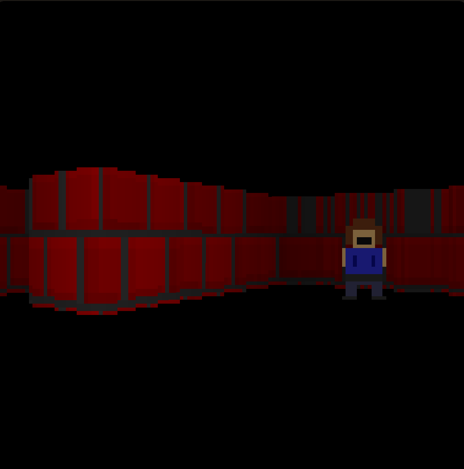

# 2.5D Graphics on Mojo (+ Python/pygame)



```python
from doom import export as ext

level    = ext.Map()
player   = ext.Player(4.5, 4.5, 0.0)   # x, y, угол
level.add_entity(player)               # спрайты уровня
engine   = ext.Engine(level)
renderer = ext.Renderer(level)

candidate = player.move_forward()      # Player — value-тип: вернулся НОВЫЙ
if not engine.check_collision(candidate):
    player = candidate

hex_rgb = renderer.render(player)      # 128*128*6 символов
ext.Renderer.width(), ext.Renderer.height()
```
---
doom.jezv.ru

## Сборка и запуск
```bash
uv sync # Установка mojo, pygame и litestar
mojo build src/doom/export.mojo --emit shared-lib -o src/doom/export.so -I src/doom
uv run -m game.main              # локальная игра в окне pygame
uv run -m web.server             # мультиплеер в браузере: http://127.0.0.1:8000
```

## Мультиплеер в браузере (`web/`)

Сервер на Litestar (бывший Starlite) держит мир целиком, клиент — только
экран и клавиатура:

```
браузер ──(ввод, JSON {"f":1,"l":0,...})──▶ web/server.py ──(кадр, binary)──▶ браузер
                                                 │
                                          web/world.py: тик 30 Гц
                                          (doom.export как библиотека)
```

* Один `Map` на процесс и один `Renderer`/`Engine` на всех: `render_view(player)`
  рейкастит от позиции конкретного игрока, поэтому кадры у игроков разные,
  а уровень общий. Игроки видны друг другу спрайтами (`level.add_entity`).
* Кадр — одно бинарное сообщение: `<fffI` (x, y, угол, число игроков) +
  128*128*3 байта RGB = 49 168 байт, 30 раз в секунду.
* Клиент (`web/static/app.js`) кладёт пиксели в `ImageData` и рисует на
  `<canvas>` с `image-rendering: pixelated` — никакой логики на клиенте.
* Безголовая проверка: `uv run -m web.probe` (два бота, ~30 кадров/с,
  проверяет размер кадра, движение, поворот и что игроки видят друг друга).

## Если сборка падает

* `unable to find suitable c compiler for linking` — для `--emit shared-lib`
  нужен C-компилятор: `sudo apt install clang`.
* `module 'export' has no attribute 'PyInit_export'` — .so собран не из
  `src/doom/export.mojo` или лежит не в `src/doom/`.
* Функции, зарегистрированные в `PythonModuleBuilder`, обязаны быть
  `@staticmethod` структур-адаптеров (`PyMap`, `PyPlayer`, `PyEngine`,
  `PyRenderer`) и принимать `self_ptr: Pointer[mut=True, T, MutUnsafeAnyOrigin]`;
  модульные `def` туда не подходят.
